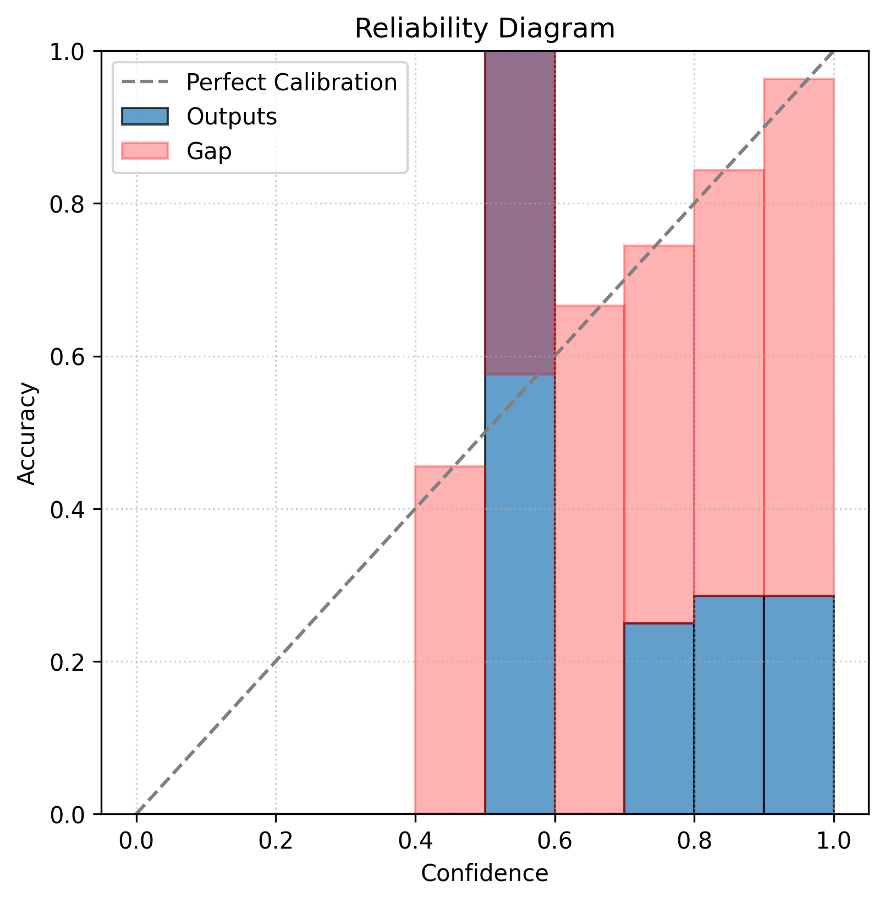
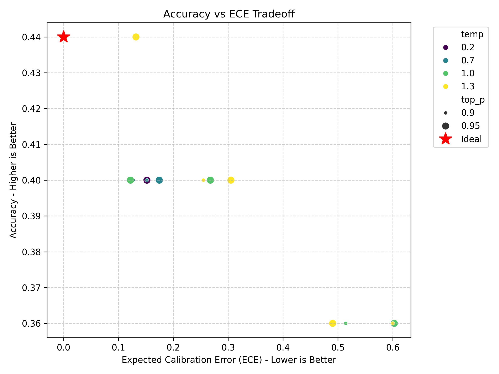

# How Sampling Choices and Probability Calibration Affect LLM Outputs

An empirical study on GPT-2 (124M) of how decoding parameters (temperature, top-p, top-k) affect the **correctness**, **calibration**, and **diversity** of model outputs. Full write-up: [report/final_report.md](report/final_report.md).

## Project timeline

Developed over about 10 weeks, January–March 2026, with weekly advisor meetings. The work went in this order:

1. Text generation with configurable sampling (`generate.py`)
2. Zero-shot multiple-choice evaluation on ARC-Easy (`eval_mcq.py`)
3. Calibration metrics: ECE, Brier, NLL, reliability and selective-accuracy plots (`calibration.py`)
4. Temperature × top-p × top-k grid sweep (`sweep.py`)
5. Accuracy vs. calibration tradeoff plots (`plot_tradeoffs.py`)
6. Post-hoc temperature scaling (`temp_scaling.py`)
7. Robustness check on SciQ (`robustness.py`)
8. Generation diversity: Distinct-n, Self-BLEU, embedding dispersion (`diversity.py`)
9. Findings notes and final report

## Layout

- `scripts/`: experiment code
- `results/`: CSV outputs (`results/sweep/` holds per-configuration results)
- `figures/`: plots used in the report
- `report/`: final report

## Key findings

- **Accuracy barely moves with temperature on multiple-choice tasks.** The ranking among answer choices holds until extreme settings.
- **Calibration does move.** At T=0.2 the model is badly overconfident: ECE climbs to about 0.50 while accuracy stays competitive.
- **T=1.0 with top-p 0.95 was the best tradeoff.** It kept accuracy and brought ECE back to its baseline floor.
- **Diversity peaks around T=1.3.** Distinct-2 rises and Self-BLEU collapses. Clipping top-p to 0.90 there kept outputs on-concept without losing n-gram variety.





## Tech stack

Python, PyTorch, Hugging Face Transformers and Datasets, sentence-transformers, scikit-learn, SciPy, NLTK, pandas, matplotlib, seaborn.

## Run it

```bash
pip install -r requirements.txt

# Zero-shot ARC-Easy eval at one decoding setting
python scripts/eval_mcq.py --model gpt2 --temp 1.0 --top_p 0.95 --top_k 0

# Full temperature x top-p x top-k sweep
python scripts/sweep.py --model gpt2

# Calibration metrics and plots from a results CSV
python scripts/calibration.py --input results/arc_easy_eval.csv

# Post-hoc temperature scaling, SciQ robustness, diversity
python scripts/temp_scaling.py --model gpt2
python scripts/robustness.py --model gpt2
python scripts/diversity.py --model gpt2
```
